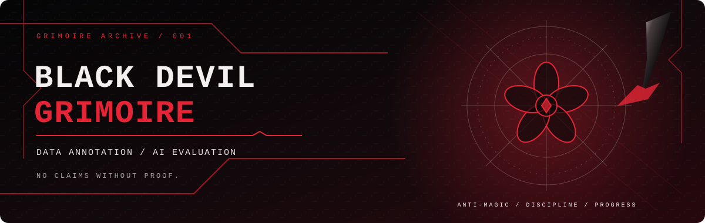

# UDAYKUMAR KOTIPALLI

### DATA ANNOTATION · AI DATA EVALUATION · DATA QUALITY

**“No shortcuts. No false claims. Just progress forged through practice.”**

[GitHub](https://github.com/Udaykumar-Kotipalli) ·
[Repositories](https://github.com/Udaykumar-Kotipalli?tab=repositories) ·
[LinkedIn](https://www.linkedin.com/in/REPLACE_WITH_YOUR_LINKEDIN) ·
[Portfolio](REPLACE_WITH_YOUR_PORTFOLIO_URL)

---

`BLACK DEVIL GRIMOIRE` &nbsp; / &nbsp; `OPERATOR FILE 001` &nbsp; / &nbsp; `SYSTEM: ACTIVE`

## `01 — THE OPERATOR`

<table>
<tr>
<td valign="top" width="62%">

### A little about me

I'm a Computer Science Engineering graduate building my professional path around **data annotation, AI data evaluation, data quality, and analytical problem-solving**.

I care about following task guidelines carefully, documenting decisions clearly, and producing work that can be reviewed and improved.

- **Current direction:** Data Annotation and AI Data Evaluation
- **Based in:** Hyderabad, India
- **Approach:** Detail-oriented, evidence-led, quality-focused
- **Goal:** Build practical portfolio projects with clear methods and reproducible results

</td>
<td valign="top" width="38%">

### `STATUS WINDOW`

| ATTRIBUTE | CURRENT STATE |
|:--|:--|
| Class | `Data / AI Evaluation` |
| Mode | `Learn · Build · Verify` |
| Focus | `Quality & consistency` |
| Next quest | `Publish real projects` |

Theme labels are decorative, not professional rankings.

</td>
</tr>
</table>

## `02 — THE GRIMOIRE` / SKILL ARSENAL

*Only list skills you can discuss honestly and demonstrate when asked.*

<table>
<tr>
<td width="50%" valign="top">

#### `SPELL TYPE: DATA QUALITY`

- Data annotation
- AI output evaluation
- Quality review and guideline adherence
- Structured documentation

</td>
<td width="50%" valign="top">

#### `SPELL TYPE: TECHNICAL`

- Python — practice / project use
- Git and GitHub — profile and repository workflows
- CSV and structured data workflows — list only if used in your work

</td>
</tr>
</table>

> **Grimoire rule:** Remove anything you cannot currently explain or demonstrate. Add tools only after you've used them.

## `03 — ACTIVE MISSIONS`

The following are **portfolio project ideas**, not claims of completed work. Change their status and links only when the repositories are real.

<table>
<tr>
<td width="50%" valign="top">

### Mission 01 / Data Quality Inspector

Check a dataset for missing values, duplicate rows, inconsistent formats, and simple validation errors.

`Suggested stack: Python · pandas`

**Status:** `PLANNED`

[Add repository](https://github.com/Udaykumar-Kotipalli/REPLACE_WITH_REPO)

</td>
<td width="50%" valign="top">

### Mission 02 / Annotation QA Checklist

Create a repeatable checklist for annotation review, common error categories, and consistent quality decisions.

`Suggested stack: Markdown · CSV`

**Status:** `PLANNED`

[Add repository](https://github.com/Udaykumar-Kotipalli/REPLACE_WITH_REPO)

</td>
</tr>
<tr>
<td width="50%" valign="top">

### Mission 03 / AI Evaluation Rubric

Document a clear rubric for checking AI responses for relevance, instruction following, factual support, and clarity.

`Suggested stack: Markdown · Python optional`

**Status:** `PLANNED`

[Add repository](https://github.com/Udaykumar-Kotipalli/REPLACE_WITH_REPO)

</td>
<td width="50%" valign="top">

### Mission 04 / Data Portfolio Series

Publish small practice projects with setup instructions, sample data, methods, findings, and limitations.

**Status:** `UPDATE TO CURRENT STATUS`

[Browse repositories](https://github.com/Udaykumar-Kotipalli?tab=repositories)

</td>
</tr>
</table>

## `04 — FORGED ARTIFACTS` / FEATURED PROJECTS

> Replace these cards with **real repositories**. Do not list a proposed idea here as a completed project.

<table>
<tr>
<td valign="top" width="50%">

### Artifact α — `[PROJECT NAME]`

**Problem:** What real problem does it address?

**Build:** What did you implement, and how can someone verify it?

**Tools:** `[ACTUAL TECHNOLOGIES]`

[Source code](https://github.com/Udaykumar-Kotipalli/REPLACE_WITH_REPO)

</td>
<td valign="top" width="50%">

### Artifact β — `[PROJECT NAME]`

**Problem:** Briefly describe the task or use case.

**Build:** State the real functionality and any meaningful limitations.

**Tools:** `[ACTUAL TECHNOLOGIES]`

[Source code](https://github.com/Udaykumar-Kotipalli/REPLACE_WITH_REPO)

</td>
</tr>
</table>

## `05 — DEVIL'S SYSTEM` / GITHUB ACTIVITY

These third-party cards may be rate-limited or unavailable. Language breakdowns reflect public repository contents, not verified proficiency. Remove this section if the cards do not load reliably.

## `06 — POWER PROGRESSION` / ROADMAP

| Milestone | Status | Evidence |
|:--|:--|:--|
| B.Tech in Computer Science Engineering | `COMPLETED` | Education |
| Data annotation / AI evaluation direction | `ACTIVE` | Describe only non-confidential work you are allowed to share |
| Data quality inspection project | `PLANNED` | Publish code, sample data, and tests |
| Reproducible analysis project | `PLANNED` | Add setup steps, method, and limitations |
| Consistent project documentation | `ONGOING` | Keep repository READMEs accurate and maintainable |

## `07 — TRANSMISSION` / CONTACT

**Open to connecting around data quality, annotation, evaluation, and practical portfolio work.**

[GitHub profile](https://github.com/Udaykumar-Kotipalli) ·
[GitHub repositories](https://github.com/Udaykumar-Kotipalli?tab=repositories) ·
[LinkedIn](https://www.linkedin.com/in/REPLACE_WITH_YOUR_LINKEDIN)

---

### “A five-leaf grimoire means nothing without the will to keep fighting.”

BLACK DEVIL GRIMOIRE // LEARN WITH PURPOSE · VERIFY THE DETAILS · BUILD THE PROOF

